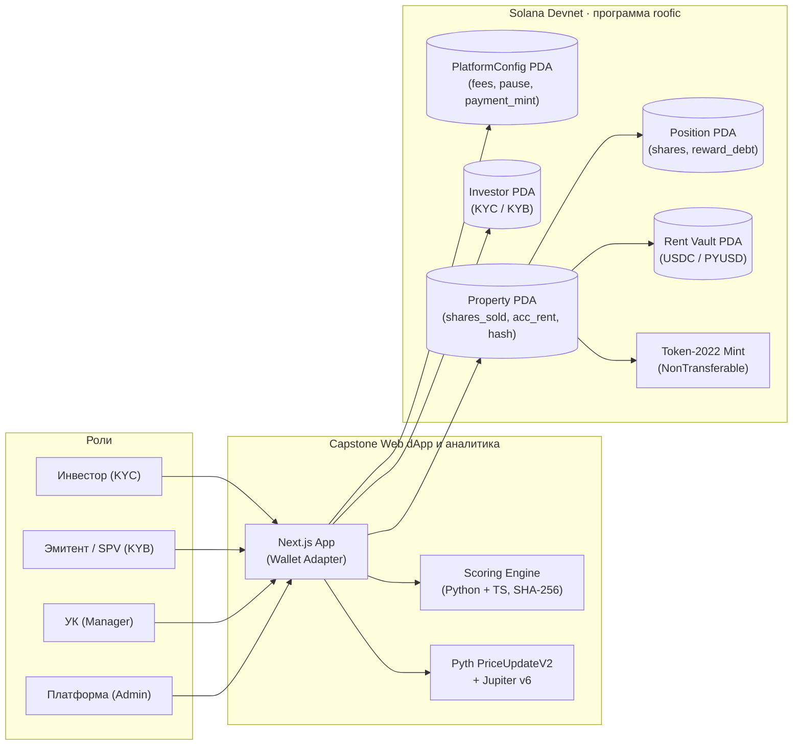

<div align="center">


# Roofic

**Платформа фракционной токенизации арендной недвижимости (RWA) на Solana**

[](https://github.com/Abdulla-Nurislam/Roofic/actions/workflows/ci.yml)


[](LICENSE)

</div>

---

## О проекте

### Проблема
Порог входа в доходную недвижимость начинается от \$50 000–\$100 000, оформление сделок занимает недели, а расчёт и распределение арендного дохода остаются непрозрачными для розничного инвестора.

### Решение
**Roofic** позволяет верифицированному инвестору купить долю доходного объекта недвижимости от **\$100 USDC / PYUSD** и получать арендный доход пропорционально доле через ончейн-аккумулятор $O(1)$.
- Доли выпускаются как **Token-2022 (`NonTransferable`)** под управлением PDA объекта.
- Детерминированный модуль скоринга рассчитывает чистую доходность (`bear` / `base` / `bull`) и риск-скор (`0..100`, грейды `A`–`D`), фиксируя `SHA-256` хэш оценки (`valuation_hash`) ончейн.
- Аварийная пауза и отзыв KYC никогда не блокируют `claim_rent` — накопленный доход инвесторов всегда доступен к выводу.

---

## Архитектура



Подробная схема PDA, формулы распределения аренды и проектные решения — в [`docs/architecture.md`](docs/architecture.md). Модель рисков и угроз — в [`docs/risk-and-security-model.md`](docs/risk-and-security-model.md).

---

## Ключевые возможности Capstone-протокола

| Возможность | Реализация |
|---|---|
| Ролевая модель (4 роли) | `admin` (через `ProgramData` upgrade authority), `owner` (KYB), `manager` (УК), `investor` (KYC) |
| Стейблкоин-расчёты | `TokenInterface` + `transfer_checked` (SPL USDC и Token-2022 PYUSD) с проверкой на отсутствие `TransferFee`/`TransferHook`/`PermanentDelegate` |
| Защита долей и пула | `NonTransferable` Token-2022 + учёт по монотонному `property.shares_sold` (защита от burn-манипуляции) |
| Распределение аренды за $O(1)$ | Аккумулятор `acc_rent_per_share` с масштабом `1e12` (`u128`), закон сохранения средств проверен тестами |
| Несгораемый вывод средств | `claim_rent` работает даже при `paused = true` и после отзыва KYC (`revoke_investor`) |
| Ончейн-скоринг и DeFi | Сверка Python ↔ TypeScript (`SHA-256 valuation_hash`), живые фиды Pyth (`SOL/USD`, `USDC/USD`) и котировка Jupiter v6 |

---

## Карта курса

Репозиторий организован **по неделям тематического плана**: каждая папка `week-NN-*` — самостоятельная лабораторная с собственным `README.md`, а финальный продукт находится в [`capstone/`](capstone/).

| Неделя | Тема | РО | Папка | Статус |
|-------:|------|:--:|-------|:------:|
| 3 | Rust для Solana-разработчика | РО2 | [week-03-rust-cli](week-03-rust-cli/) | ✅ (7 тестов) |
| 4 | Первая Solana Program (native) | РО2 | [week-04-native-program](week-04-native-program/) | ✅ (4 теста, Devnet) |
| 5 | Anchor Framework: Counter | РО2 | [week-05-anchor-counter](week-05-anchor-counter/) | ✅ (7 тестов, Devnet) |
| 6 | Accounts, PDAs: on-chain профиль | РО2 | [week-06-pda-profile](week-06-pda-profile/) | ✅ (7 тестов, Devnet) |
| 7 | SPL Tokens & Token Extensions | РО2 | [week-07-spl-token](week-07-spl-token/) | ✅ (Token-2022, Devnet) |
| 8 | РК1 · Build Sprint: первый Web3 MVP | РО3 | [week-08-mvp](week-08-mvp/) | ✅ (9 тестов, Next.js, Devnet) |
| 9 | DeFi на Solana (Pyth, Jupiter, Kamino) | РО3 | [week-09-defi](week-09-defi/) | ✅ (5 тестов + интеграция) |
| 10 | RPC, API и blockchain data | РО3 | [week-10-dashboard](week-10-dashboard/) | ✅ (7 тестов, Next.js) |
| 11 | CPI и composable applications | РО3 | [week-11-cpi](week-11-cpi/) | ✅ (11 тестов, 2 программы) |
| 12 | Security & Exploit Lab | РО4 | [week-12-security-lab](week-12-security-lab/) | ✅ (11 эксплойт/фикс-тестов) |
| 13 | RWA, Stablecoins и платежи | РО4 | [week-13-rwa-design](week-13-rwa-design/) | ✅ (12 тестов финмодели) |
| 14 | Capstone Build Week | РО5 | [capstone](capstone/) | ✅ (23 Rust + 7 Python тестов, Next.js, Devnet) |
| 15 | РК2 · Solana Demo Day (5–7 мин питч и live demo) | РО5 | [docs/pitch-and-demo.md](docs/pitch-and-demo.md) | ✅ |
| 16 | Защита проекта (Q&A, архитектура и безопасность) | РО1–5 | [docs/pitch-and-demo.md](docs/pitch-and-demo.md) | ✅ |

---

## Документация проекта

| Документ | Содержание |
|---|---|
| [`docs/architecture.md`](docs/architecture.md) | Схема PDA, потоки средств, математика $O(1)$ и ключевые проектные решения |
| [`docs/risk-and-security-model.md`](docs/risk-and-security-model.md) | Модель угроз, защитные инварианты и осознанные trade-offs |
| [`docs/security-policy.md`](docs/security-policy.md) | Поддерживаемые сети, зона ответственности и порядок сообщения об уязвимостях |
| [`docs/devnet-deployments.md`](docs/devnet-deployments.md) | Все 9 развёрнутых программ, адреса токенов, Pyth-фидов и Devnet-транзакций |
| [`docs/team.md`](docs/team.md) | Состав команды Roofic и матрица вклада участников по неделям |
| [`docs/pitch-and-demo.md`](docs/pitch-and-demo.md) | Сценарий Demo Day (Неделя 15) и технические ответы к защите (Неделя 16) |
| [`CONTRIBUTING.md`](CONTRIBUTING.md) | Регламент веток, локальные проверки и Definition of Done |

---

## Быстрый старт и окружение

| Инструмент | Версия |
|---|---|
| Rust | `1.89+` (`rust-toolchain.toml` в Anchor-проектах) |
| Solana CLI (Agave) | `4.x` (`cargo build-sbf`) |
| Anchor | `1.2.0` (`anchor-lang = 1.2.0`, `anchor-spl = 1.2.2`) |
| Node.js | `22.x` |
| Python | `3.10+` |

```bash
# Сборка и интеграционные LiteSVM-тесты Capstone-контракта
cd capstone
cargo build-sbf --manifest-path programs/roofic/Cargo.toml
cargo test

# Опциональный Devnet smoke-тест (читает живые аккаунты в Solana Devnet)
ROOFIC_DEVNET=1 cargo test devnet_smoke -- --nocapture

# Юнит-тесты Python-скоринга и RWA финмодели
python3 -m unittest discover -s capstone/scoring -v
python3 -m unittest discover -s week-13-rwa-design/model -v

# Запуск веб-интерфейса Capstone (http://localhost:3014)
cd capstone/app && npm ci && npm run dev
```

---

## Лицензия

Проект распространяется под лицензией **Apache License 2.0** — полный текст в [`LICENSE`](LICENSE), атрибуция авторов и правила использования товарного знака — в [`NOTICE`](NOTICE).
- Включает явное предоставление патентных прав и защиту от патентных исков (Раздел 3 Apache 2.0).
- При распространении форков или производных продуктов сохранение атрибуции из файла [`NOTICE`](NOTICE) обязательно (Раздел 4(d) Apache 2.0).
- Товарный знак и бренд **Roofic** защищены и не передаются по лицензии (Раздел 6 Apache 2.0).
