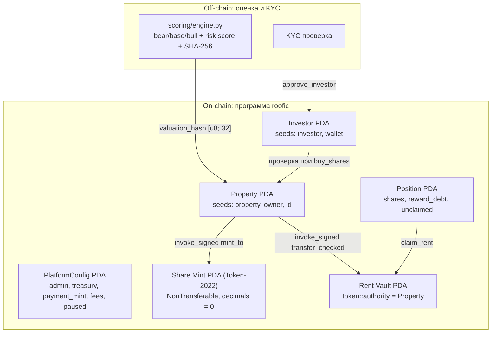

# Неделя 14 — Capstone: платформа Roofic

| | |
|---|---|
| **Задание** | Собрать финальный прототип продукта, объединяющий смарт-контракты, токенизацию, платежи в стейблкоинах, безопасность и аналитический модуль |
| **РО** | РО5 — комплексная разработка и защита блокчейн-проекта на Solana |
| **Program ID** | `EvLmbfYUs5m5YHWm4QWCeQfy63df4BBiaBiZw8Rf12mo` |

## Что изменилось от MVP (неделя 8) к Capstone

| Компонент | MVP (неделя 8) | Capstone (неделя 14) |
|-----------|----------------|----------------------|
| **Валюта расчётов** | Нативный SOL (курсовой риск) | Любой стейблкоин (USDC / PYUSD) через `TokenInterface` + `transfer_checked` |
| **Доля объекта** | Только запись `Position` | `Position` + токен **Token-2022** (`0 decimals`, расширение `NonTransferable`, mint authority = PDA объекта) |
| **Доступ инвесторов** | Любой кошелёк | Ончейн **KYC allow-list** (`approve_investor` / `revoke_investor`) |
| **Комиссии платформы** | Нет | Настраиваемые `sale_fee_bps` (при покупке долей) и `rent_fee_bps` (при внесении аренды), потолок `MAX_FEE_BPS = 20%` |
| **Роли объекта** | Владелец = плательщик аренды | Разделены `owner` (получает выручку от продажи долей) и `manager` (вносит аренду) |
| **Аварийная пауза** | Нет | `set_paused(true)` останавливает листинг, покупку и внесение аренды, но **никогда не блокирует `claim_rent`** |
| **Оценка и риск** | Нет | Модуль [`scoring/engine.py`](scoring/engine.py) считает bear/base/bull доходность, риск-скор 0–100 и SHA-256 `valuation_hash`, записываемый ончейн |

## Архитектура



### Инструкции программы [`programs/roofic/src/lib.rs`](programs/roofic/src/lib.rs)

1. `initialize_platform(rent_fee_bps, sale_fee_bps)` — создаёт `PlatformConfig`, фиксирует `payment_mint` и `treasury`.
2. `set_paused(paused)` / `set_fees(rent_fee_bps, sale_fee_bps)` — управление платформой (только `admin`).
3. `approve_investor()` / `revoke_investor()` — добавление и отзыв кошелька из KYC-реестра (с возвратом rent при закрытии).
4. `create_property(id, name, total_shares, price_per_share, manager, valuation_hash)` — создаёт `Property`, `vault` и инициализирует Token-2022 `share_mint` с расширением `NonTransferable`.
5. `buy_shares(shares)` — проверяет KYC-запись инвестора, переводит `cost - fee` владельцу и `fee` в казну, начисляет прошлый доход в `unclaimed`, обновляет `reward_debt` и выпускает share-токены.
6. `deposit_rent(amount)` — вызывается `manager`; удерживает `rent_fee_bps` в казну, остаток кладёт в `vault` и увеличивает `acc_rent_per_share`.
7. `claim_rent()` — выплачивает инвестору накопленный доход из `vault` по подписи PDA объекта (работает даже при `paused = true`).

### Почему `NonTransferable` для share-токенов
Учёт арендного дохода ведётся через `reward_debt` в аккаунте `Position`. Если бы share-токен свободно переводился между кошельками в обход программы, инвестор мог бы забрать аренду, перевести токены на второй кошелёк и нарушить инвариант начислений. Поэтому в Capstone share-токен создаётся с расширением `NonTransferable` (soulbound к верифицированному инвестору), а для запуска вторичного рынка в [`../week-13-rwa-design/RWA_DESIGN.md`](../week-13-rwa-design/RWA_DESIGN.md) спроектирован переход на `TransferHook`.

## Модуль оценки доходности и риска (`scoring/`)

Расположен в [`scoring/engine.py`](scoring/engine.py).
- Считает чистую доходность инвестора в трёх сценариях (`bear`, `base`, `bull`) с учётом вакантности, операционных расходов, комиссии управляющего и комиссии платформы.
- Раскладывает риск-скор (`0..100`, грейды `A`–`D`) на 4 прозрачных фактора: `vacancy`, `operating_costs`, `building_age`, `downside_yield`.
- Формирует детерминированный SHA-256 хэш отчёта (`valuation_hash`), который передаётся в `create_property` и хранится в аккаунте `Property`.

```bash
cd scoring
python3 -m unittest -v
python3 engine.py
```

## Тесты смарт-контракта (LiteSVM)

В [`programs/roofic/tests/roofic_test.rs`](programs/roofic/tests/roofic_test.rs) — **15 интеграционных тестов**, проверяющих все инварианты, роли, коды ошибок и сохранение денег как для классического **SPL Token (USDC)**, так и для **Token-2022 (PYUSD)**:

```bash
anchor build
cargo test
```

| Тест | Что проверяется |
|------|-----------------|
| `property_creation_makes_a_non_transferable_token2022_share_mint` | Share-mint принадлежит Token-2022, authority = `Property` PDA, 0 decimals, включено расширение `NonTransferable` |
| `only_the_admin_can_pause_and_fees_are_capped` | Посторонний не может поставить паузу (`NotAdmin`), комиссия > 20% отвергается (`FeeTooHigh`) |
| `kyc_gate_blocks_unapproved_wallets_until_approved_and_again_after_revoke` | Без KYC покупка невозможна; после `approve_investor` работает; после `revoke_investor` снова блокируется |
| `buy_splits_payment_between_owner_and_treasury_and_mints_shares` | Инвестор платит ровно `cost`, владелец получает `cost - fee`, казна — `fee`, выпускаются share-токены |
| `cannot_oversell_the_property` | Нельзя купить больше `total_shares` суммарно по всем инвесторам |
| `shares_cannot_be_transferred_between_wallets` | Попытка перевода share-токена через Token-2022 `TransferChecked` падает с `TokenError::NonTransferable` |
| `rent_is_split_pro_rata_after_the_platform_fee` | Комиссия с аренды уходит в казну, остаток делится пропорционально долям (10:30), повторный claim невозможен |
| `late_buyer_gets_nothing_from_earlier_rent` | Покупатель, вошедший после `deposit_rent`, не получает прошлую аренду |
| `rent_accrued_before_a_second_purchase_is_kept` | Докупка долей сохраняет ранее начисленную аренду в `unclaimed` |
| `only_the_property_manager_can_deposit_rent` | Даже владелец объекта не может вызвать `deposit_rent`, если он не `manager` (`NotManager`) |
| `nobody_can_claim_someone_elses_position` | Нельзя забрать чужую аренду (`ConstraintSeeds`) |
| `pause_blocks_buying_and_rent_but_never_claims` | Пауза блокирует `buy_shares` и `deposit_rent`, но `claim_rent` остаётся доступным |
| `money_is_conserved_with_the_spl_token_program` | Сумма всех балансов до и после серии покупок, депозитов и выплат совпадает до копейки (SPL Token) |
| `money_is_conserved_with_the_token2022_program` | То же самое при использовании Token-2022 в качестве платёжного токена |
| `wrong_payment_token_program_is_rejected` | Подмена программы платёжного токена отвергается |
