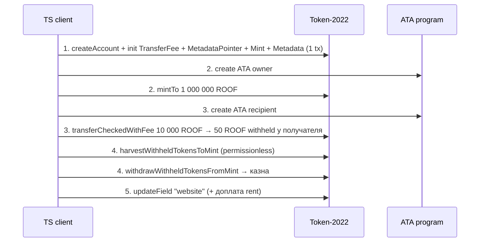

# Неделя 7 — SPL Tokens и Token Extensions

| | |
|---|---|
| **Задание** | Создать собственный токен: выпуск, transfer, metadata и взаимодействие через client |
| **РО** | РО2 — SPL Tokens и Token Extensions |
| **Ответственный** | Абдулла Нурислам (код), Кадирханов Жангир (ревью) |

## Что сделано

Токен **Roofic (ROOF)** — utility-токен платформы Roofic на программе **Token-2022** с тремя расширениями:

| Расширение | Зачем в продукте |
|------------|------------------|
| `TransferFeeConfig` | 0.5% с каждого перевода (макс. 5 000 ROOF) удерживается и идёт в казну платформы |
| `MetadataPointer` | Указывает, что metadata хранится прямо в аккаунте mint — без Metaplex |
| `TokenMetadata` | `name`, `symbol`, `uri` + произвольные поля (`project`, `category`, `website`…) on-chain |


## Архитектура



| Файл | Шаг |
|------|-----|
| [`src/common.ts`](src/common.ts) | Подключение, кошелёк, параметры токена, состояние между запусками |
| [`src/01-create-mint.ts`](src/01-create-mint.ts) | Создание mint со всеми расширениями одной атомарной транзакцией |
| [`src/02-mint-to.ts`](src/02-mint-to.ts) | ATA владельца + выпуск 1 000 000 ROOF |
| [`src/03-transfer.ts`](src/03-transfer.ts) | `transferCheckedWithFee`, расчёт комиссии по эпохе |
| [`src/04-collect-fees.ts`](src/04-collect-fees.ts) | Сбор удержанных комиссий в казну |
| [`src/05-update-metadata.ts`](src/05-update-metadata.ts) | Добавление поля metadata с автодоплатой rent |
| [`src/06-inspect.ts`](src/06-inspect.ts) | Чтение всего состояния токена on-chain |
| [`src/demo.ts`](src/demo.ts) | Весь сценарий + `assert`-проверки (интеграционный тест) |
| [`metadata/roof.json`](metadata/roof.json) | Off-chain JSON по `uri` |

### Ключевые решения
- **Порядок инструкций важен:** расширения инициализируются *до* `InitializeMint`; `TokenMetadata` — *после* (ей нужен mint authority).
- **Rent под metadata оплачивается заранее:** аккаунт создаётся размером `getMintLen(fixed extensions)`, но lamports — на полный размер с metadata. Token-2022 сам делает `realloc`.
- **`transferCheckedWithFee`** требует указать ожидаемую комиссию, поэтому authority не может незаметно поднять ставку между подписанием и исполнением транзакции.
- **Комиссия удерживается у получателя**, а не переводится сразу: перевод не трогает аккаунт казны (нет write-lock, лучше параллелизм).

## Запуск

```bash
npm install

# Devnet (кошелёк из ~/.config/solana/id.json, нужно ~0.05 SOL)
npm run create && npm run mint && npm run transfer && npm run fees && npm run metadata && npm run inspect

# Весь сценарий с проверками на локальном валидаторе
solana-test-validator -r          # в отдельном терминале
CLUSTER=localnet npm run demo
```

## Результат в Devnet

См. раздел ниже (заполняется после деплоя) и [docs/devnet-deployments.md](../docs/devnet-deployments.md).

<!-- DEVNET_RESULTS -->
