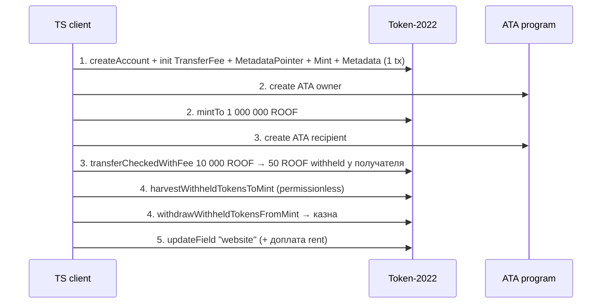

# Неделя 7 — SPL Tokens и Token Extensions

| | |
|---|---|
| **Задание** | Создать собственный токен: выпуск, transfer, metadata и взаимодействие через client |
| **РО** | РО2 — SPL Tokens и Token Extensions |
| **Ответственный** | Абдулла Нурислам (код), Кадирханов Жангир (ревью) |

## Что сделано

Токен **Roofic (ROOF)** — utility-токен платформы Roofic на программе **Token-2022** с тремя расширениями:

| Расширение | Зачем в продукте |
|------------|------------------|
| `TransferFeeConfig` | 0.5% с каждого перевода (макс. 5 000 ROOF) удерживается и идёт в казну платформы |
| `MetadataPointer` | Указывает, что metadata хранится прямо в аккаунте mint — без Metaplex |
| `TokenMetadata` | `name`, `symbol`, `uri` + произвольные поля (`project`, `category`, `website`…) on-chain |


## Архитектура



| Файл | Шаг |
|------|-----|
| [`src/common.ts`](src/common.ts) | Подключение, кошелёк, параметры токена, состояние между запусками |
| [`src/01-create-mint.ts`](src/01-create-mint.ts) | Создание mint со всеми расширениями одной атомарной транзакцией |
| [`src/02-mint-to.ts`](src/02-mint-to.ts) | ATA владельца + выпуск 1 000 000 ROOF |
| [`src/03-transfer.ts`](src/03-transfer.ts) | `transferCheckedWithFee`, расчёт комиссии по эпохе |
| [`src/04-collect-fees.ts`](src/04-collect-fees.ts) | Сбор удержанных комиссий в казну |
| [`src/05-update-metadata.ts`](src/05-update-metadata.ts) | Добавление поля metadata с автодоплатой rent |
| [`src/06-inspect.ts`](src/06-inspect.ts) | Чтение всего состояния токена on-chain |
| [`src/demo.ts`](src/demo.ts) | Весь сценарий + `assert`-проверки (интеграционный тест) |
| [`metadata/roof.json`](metadata/roof.json) | Off-chain JSON по `uri` |

### Ключевые решения
- **Порядок инструкций важен:** расширения инициализируются *до* `InitializeMint`; `TokenMetadata` — *после* (ей нужен mint authority).
- **Rent под metadata оплачивается заранее:** аккаунт создаётся размером `getMintLen(fixed extensions)`, но lamports — на полный размер с metadata. Token-2022 сам делает `realloc`.
- **`transferCheckedWithFee`** требует указать ожидаемую комиссию, поэтому authority не может незаметно поднять ставку между подписанием и исполнением транзакции.
- **Комиссия удерживается у получателя**, а не переводится сразу: перевод не трогает аккаунт казны (нет write-lock, лучше параллелизм).
- **Mint authority и fee authority — один ключ владельца (не отозваны).** Для utility-токена учебного проекта это осознанное упрощение, но в продакшене это точка централизации: владелец может выпускать новые ROOF и менять ставку комиссии. Перед запуском нужно передать роли мультисигу или отозвать mint authority (`setAuthority(..., null)`).

## Запуск

```bash
npm install

# Devnet (кошелёк из ~/.config/solana/id.json, нужно ~0.05 SOL)
npm run create && npm run mint && npm run transfer && npm run fees && npm run metadata && npm run inspect

# Весь сценарий с проверками на локальном валидаторе
solana-test-validator -r          # в отдельном терминале
CLUSTER=localnet npm run demo
```

`demo` — это интеграционный тест: он проверяет supply, комиссию 0,5%, вывод комиссий в казну, metadata, а также **негативные сценарии** с конкретным кодом ошибки Token-2022:

| Атака | Ожидаемый отказ |
|-------|-----------------|
| Перевод с неверно указанной комиссией | `FeeMismatch` (`0x20`) |
| `mintTo` чужим ключом (не mint authority) | `OwnerMismatch` (`0x4`) |
| Вывод накопленных комиссий чужим ключом | `OwnerMismatch` (`0x4`) |

## Результат в Devnet

- **Mint (`ROOF`, Token-2022):** [`7esVWfVcskCHktfJxzd33J64BNc74jd7YYdzwBKZNbqP`](https://explorer.solana.com/address/7esVWfVcskCHktfJxzd33J64BNc74jd7YYdzwBKZNbqP?cluster=devnet)
- **Owner / Treasury ATA (`990 050 ROOF`):** [`ANX2SCdnWAW6Rmu38aaTXFww5kwQgMkqTtqNfBXCR3Qz`](https://explorer.solana.com/address/ANX2SCdnWAW6Rmu38aaTXFww5kwQgMkqTtqNfBXCR3Qz?cluster=devnet)
- **Recipient ATA (`9 950 ROOF`):** [`3A5Yq3wnFSSJMVpyWwjvJnwYYyPi7W1kYm7G8vNAUJbE`](https://explorer.solana.com/address/3A5Yq3wnFSSJMVpyWwjvJnwYYyPi7W1kYm7G8vNAUJbE?cluster=devnet)

| Шаг | Транзакция (Solana Explorer Devnet) |
|-----|-------------------------------------|
| 1. `createMint` (TransferFee + Metadata) | [`51zBhK44…XyhDfDM`](https://explorer.solana.com/tx/51zBhK4434ZJiEk1APKrgZTA7FLzy7uUKV1pqxBPH8uuVPZnWhCxnp3NkmYQUNJXoBgA8YT9KvMJUBLL9XyhDfDM?cluster=devnet) |
| 2. `mintTo` (1 000 000 ROOF) | [`3aabiqAN…RMd5Zk6V`](https://explorer.solana.com/tx/3aabiqAN9tk5SRaZxWFHPRqtD1x5cYC6GEF9gZJMds34Nisu6ZUq6ckbwmNvFBWGfu8dxBDtVcjDbGT6RMd5Zk6V?cluster=devnet) |
| 3. `transferWithFee` (10 000 ROOF, удержано 50 ROOF) | [`3wAsehNp…JME2dn72`](https://explorer.solana.com/tx/3wAsehNp8EKG5xayHiryJdqbw87ptTZqepkuQ9UgAYeU9CKczyKTxchKzjcbVPiUasKyrRUCJmkfkTjyJME2dn72?cluster=devnet) |
| 4a. `harvestFees` (50 ROOF → mint) | [`3wpeq9v1…Fo3fRCME`](https://explorer.solana.com/tx/3wpeq9v17KUBXVia56bz2poYuecrQDpWRYS58cRSkrE9Bb6tutBHsa2Q4Qkdwe3yv3TdVfp5u1HuVSCZFo3fRCME?cluster=devnet) |
| 4b. `withdrawFees` (50 ROOF → казна) | [`3Fb34EFC…KhgbPqV6`](https://explorer.solana.com/tx/3Fb34EFC2azXFC7n4bjDoybMx1e2YaVfAnpUqGS4WcobpHrGD4W7VtxutPphgEp5fjbAM7kY4zwMyrQnKhgbPqV6?cluster=devnet) |
| 5. `updateMetadata:website` | [`5zPYbWR1…LR6u5m6x`](https://explorer.solana.com/tx/5zPYbWR1bqeqewtCyQRRcFMjCM49s99Ns4NCayyUKvwASKp79zW9AxXBDQk6rn6ndPZ8WkRC9a1vk1HoLR6u5m6x?cluster=devnet) |
