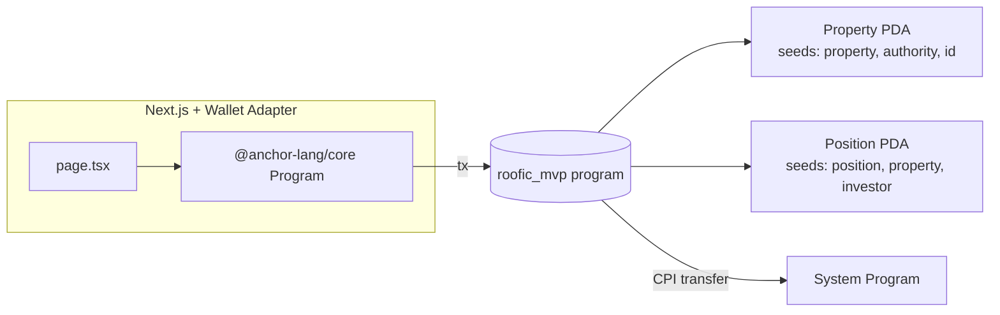

# Неделя 8 — РК1 · Build Sprint: первый Web3 MVP

| | |
|---|---|
| **Задание** | Создать работающий прототип в формате мини-хакатона |
| **РО** | РО3 — разработка и интеграция Web3-приложений на Solana |
| **Команда** | Нурислам: программа и интеграция · Жангир: frontend · Мухаммедали: user flow · Нұрым: pitch |

## Pitch (30 секунд)

> Чтобы инвестировать в арендную недвижимость, нужны десятки тысяч долларов, нотариус и доверие к управляющему.
> **Roofic** делит объект на доли, которые можно купить с кошелька за минуту. Арендный доход распределяется
> **смарт-контрактом** пропорционально доле, и каждый может проверить это on-chain.

## Что умеет MVP

| # | Пользовательский сценарий | Инструкция программы |
|---|---------------------------|----------------------|
| 1 | Владелец листит объект: N долей по цене X SOL | `create_property` |
| 2 | Инвестор покупает доли, SOL сразу уходит владельцу | `buy_shares` |
| 3 | Владелец вносит арендный доход | `deposit_rent` |
| 4 | Инвестор забирает свою часть дохода | `claim_rent` |

## Архитектура



**Аккаунты:**

| Аккаунт | Seeds | Данные |
|---------|-------|--------|
| `Property` | `["property", authority, id_le]` | name, location, total/sold shares, цена, `acc_rent_per_share`, сумма внесённой аренды. **Сам хранит lamports аренды** |
| `Position` | `["position", property, investor]` | shares, `reward_debt`, `unclaimed`, `total_claimed` |

### Распределение дохода: reward-per-share accumulator
Если в цикле обходить всех инвесторов, это не масштабируется (лимит compute units и аккаунтов в транзакции). Поэтому используется аккумулятор:

```
deposit_rent(amount):   acc += amount × 1e12 / shares_sold
pending(position)     = shares × acc / 1e12 − reward_debt
при изменении shares:  unclaimed += pending;  reward_debt = new_shares × acc / 1e12
```

O(1) на любую операцию. Тест `late_buyer_does_not_receive_earlier_rent` доказывает, что новый инвестор не получает аренду, внесённую до его покупки.

### Безопасность (уже в MVP)
- `has_one = authority` на `buy_shares`: нельзя подменить получателя оплаты (тест `payment_cannot_be_redirected`).
- PDA позиции выводится из `investor` (signer), поэтому чужую позицию не заклеймить (тест `cannot_claim_someone_elses_position`).
- `checked_mul` / `checked_add`, `overflow-checks = true` в release.
- `claim_rent` списывает lamports напрямую с program-owned PDA (`sub_lamports`), без CPI.

## Тесты

```bash
anchor build
cargo test
```

```
test create_and_buy_pays_owner_and_records_position ... ok
test cannot_buy_more_than_available ... ok
test rent_is_split_pro_rata ... ok
test late_buyer_does_not_receive_earlier_rent ... ok
test accrued_rent_survives_additional_purchase ... ok
test only_owner_can_deposit_rent ... ok
test deposit_requires_shareholders ... ok
test cannot_claim_someone_elses_position ... ok
test payment_cannot_be_redirected ... ok
test result: ok. 9 passed
```

## Запуск frontend

```bash
cd app
npm install
npm run sync-idl      # копирует IDL и типы из ../target после anchor build
npm run dev           # http://localhost:3008
```

Нужен Phantom/Solflare, переключённый на **Devnet**.

## Деплой

```bash
anchor build
anchor deploy --provider.cluster devnet
```

Program ID: `4qSqEcJ7KhcFsLnURE6dHuQ8KSRkkEX56oFYiRk8zKKf`

## Ограничения MVP → что будет в Capstone
| MVP | Capstone (неделя 14) |
|-----|----------------------|
| Оплата в SOL (волатильность) | Оплата и аренда в USDC (стейблкоин) |
| Доля — запись в `Position` | Доля — Token-2022 токен (передаваемый, с metadata) |
| Нет KYC | Whitelist / KYC-реестр (требование для RWA) |
| Нет оценки объекта | ML-прогноз доходности и риск-скор |
| Нет паузы / админа | Платформенный конфиг, pause, комиссия платформы |
