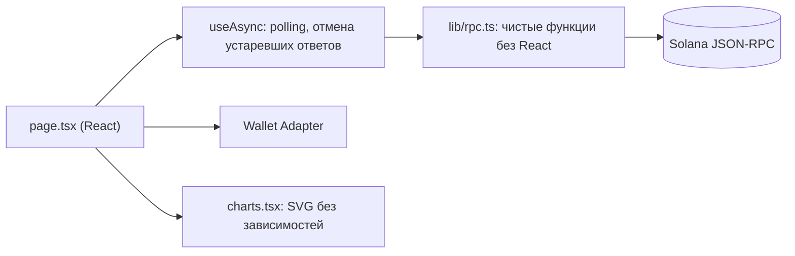

# Неделя 10 — RPC, API и blockchain data

| | |
|---|---|
| **Задание** | Построить dashboard, который читает данные Solana напрямую через RPC: баланс, токены, транзакции, активность программы |
| **РО** | РО3 — разработка и интеграция Web3-приложений на Solana |
| **Ответственный** | Кадирханов Жангир (код), Абдулла Нурислам (ревью) |

## Что умеет dashboard

Без индексера и backend — только JSON-RPC (`@solana/web3.js`).

| Раздел | Данные | RPC-методы |
|--------|--------|-----------|
| **Cluster** | slot, epoch и прогресс эпохи, TPS (без vote-транзакций), версия ноды; обновление каждые 15 с | `getEpochInfo`, `getRecentPerformanceSamples`, `getVersion` |
| **Portfolio** | баланс SOL, токены SPL Token и Token-2022 (с расширениями и on-chain metadata), любой адрес или подключённый кошелёк | `getBalance`, `getParsedTokenAccountsByOwner`, `getParsedAccountInfo` |
| **Transactions** | последние 12 транзакций: статус, разбор инструкций, изменение SOL, программы | `getSignaturesForAddress`, `getParsedTransactions` |
| **Program activity** | объём, доля ошибок и гистограмма активности по последним 100 сигнатурам; список программ редактируется | `getSignaturesForAddress` |

Переключатель сети: Devnet / Mainnet / Localnet. Публичные RPC имеют rate limit — для длительной работы нужен свой endpoint.

## Архитектура



| Файл | Назначение |
|------|-----------|
| [`src/lib/rpc.ts`](src/lib/rpc.ts) | Слой данных: типы и функции `fetch*`, не зависит от React — легко тестировать |
| [`src/lib/hooks.ts`](src/lib/hooks.ts) | `useAsync`: загрузка, ошибка, polling, повторный запрос |
| [`src/app/providers.tsx`](src/app/providers.tsx) | Выбор сети + Wallet Adapter |
| [`src/app/page.tsx`](src/app/page.tsx) | Секции dashboard |
| [`src/components/charts.tsx`](src/components/charts.tsx) | Sparkline и гистограмма на SVG |

### Ключевые решения
- **`numNonVoteTransactions` вместо `numTransactions`.** Значительную часть транзакций Solana составляют vote-транзакции валидаторов, они не отражают пользовательскую нагрузку. Типы `web3.js` отдают только общий счётчик, поэтому поле читается явно; если нода его не вернула, UI подписывает метрику «TPS (incl. votes)», а не выдаёт её за настоящий TPS.
- **Metadata токенов.** У Token-2022 `name`/`symbol` читаются из расширения `tokenMetadata` в самом mint. У обычных SPL-токенов metadata лежит в Metaplex, поэтому для известных mainnet-токенов (USDC, USDT, wSOL, mSOL, JitoSOL, JUP) есть локальная таблица, остальные показываются как `Unknown token`.
- **Устаревшие ответы отбрасываются.** При смене сети или адреса ответ предыдущего запроса не перезапишет новые данные, а данные/ошибка хранятся вместе с ключом запроса: если запрос для нового адреса упал, UI не покажет баланс и токены *прежнего* адреса как будто они принадлежат новому.
- **Лимит RPC `getMultipleAccounts` = 100 адресов.** Mint-ы токенов дедуплицируются и запрашиваются пачками по 100, поэтому кошелёк с сотнями токен-аккаунтов не ломает портфель.
- **Ошибки видны.** Любой сбой RPC показывается с кнопкой Retry, а не пустым экраном.

## Запуск

```bash
npm install
npm run dev          # http://localhost:3010
npm run typecheck
npm test             # 7 unit-тестов слоя данных (fake Connection, без сети)
npm run build
```

Нужен Phantom/Solflare, чтобы смотреть собственный портфель; для чужого адреса кошелёк не нужен.

## Проверка

Слой `rpc.ts` проверен на реальных данных devnet: кластер (TPS по 30 сэмплам, `tpsNonVote = true`), активность программы Token-2022 (100 сигнатур, 0 ошибок), баланс, токены и разбор транзакций реального кошелька.
