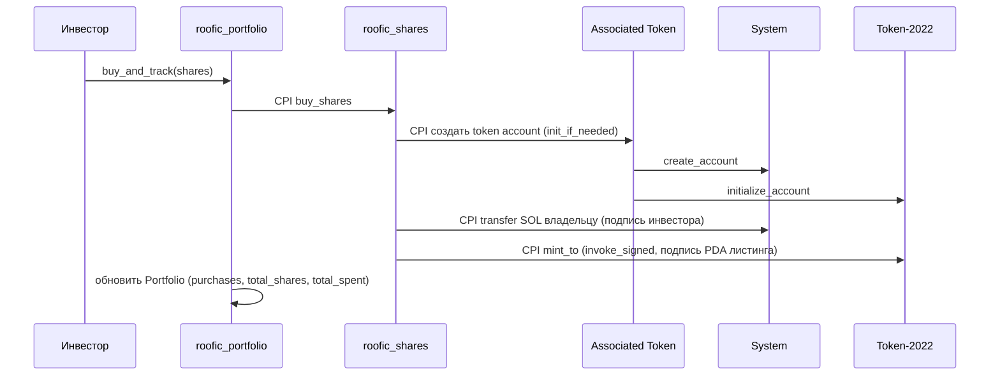

1# Неделя 11 — CPI и composable applications

| | |
|---|---|
| **Задание** | Показать, как программы вызывают друг друга: CPI, PDA-подписи, композиция нескольких программ |
| **РО** | РО3 — разработка и интеграция Web3-приложений на Solana |
| **Ответственный** | Абдулла Нурислам (код), Кадирханов Жангир (ревью) |

## Что сделано

Доли недвижимости из недели 8 (запись `Position` внутри программы) стали **токенами Token-2022**: их можно передавать, они видны в кошельке. Для этого понадобились CPI.

| Программа | Роль |
|-----------|------|
| [`roofic_shares`](programs/roofic_shares/src/lib.rs) | Листинг объекта + mint долей. `buy_shares` делает три CPI |
| [`roofic_portfolio`](programs/roofic_portfolio/src/lib.rs) | Вторая программа: вызывает `roofic_shares` через CPI и ведёт портфель инвестора |

## Архитектура



| Аккаунт | Seeds | Назначение |
|---------|-------|-----------|
| `Listing` | `["listing", authority, id_le]` | Параметры объекта; **mint authority** токена долей |
| Share mint | `["share_mint", listing]` | Token-2022 mint, 0 decimals: 1 токен = 1 доля |
| `Portfolio` | `["portfolio", investor]` | Счётчики покупок инвестора |

### Два вида CPI
- **`invoke`** — подпись уже есть в исходной транзакции: перевод SOL подписывает инвестор.
- **`invoke_signed`** — подписывает PDA: `mint_to` подписывает листинг. Подписать за PDA может только программа, которая его вывела, поэтому выпустить доли сверх `total_shares` не может никто, включая владельца.

### Ключевые решения
- **Источник истины для «продано» — `supply` mint-а**, а не отдельный счётчик: данные не могут разойтись.
- **`Program<Token2022>` и `Program<RooficShares>`** проверяют адрес программы. Без этого вызывающий подсунул бы свою программу в CPI (уязвимость *arbitrary CPI*, разбирается на неделе 12).
- **`has_one`** привязывает получателя платежа и mint к листингу — платёж нельзя перенаправить.
- **Атомарность:** если внутренний CPI упал, откатывается вся транзакция, и `Portfolio` не может записать несуществовавшую покупку.
- **Глубина вызовов:** первая покупка идёт `portfolio → shares → associated_token → token_2022/system`, это 4 уровня. Лимит стека вызовов ограничен, поэтому композицию нужно держать неглубокой.

## Тесты (LiteSVM)

```bash
anchor build
cargo test
```

| Тест | Что доказывает |
|------|----------------|
| `create_listing_makes_token2022_mint_owned_by_listing_pda` | mint принадлежит Token-2022, authority — PDA, 0 decimals |
| `buy_shares_pays_owner_and_mints_tokens` | владелец получает ровно `shares × price`, токены выпущены |
| `second_purchase_accumulates_in_same_token_account` | повторная покупка не ломает `init_if_needed` |
| `cannot_buy_more_than_total_shares_across_buyers` | лимит доли общий для всех покупателей; можно купить остаток |
| `payment_cannot_be_redirected_to_another_wallet` | ошибка `WrongAuthority` (6005) |
| `legacy_token_program_is_rejected` | подмена token program → `InvalidProgramId` (3008) |
| `shares_are_transferable_like_any_token` | перевод долей стандартным `TransferChecked`, supply не меняется |
| `buy_and_track_mints_shares_through_nested_cpi_and_records_purchase` | вложенный CPI работает, портфель обновлён |
| `purchases_accumulate_in_portfolio` | счётчики накапливаются |
| `failed_inner_cpi_reverts_everything_including_portfolio` | откат: нет токенов, нет портфеля, SOL не списан (кроме комиссии) |
| `arbitrary_cpi_target_is_rejected` | чужая программа вместо `roofic_shares` → `InvalidProgramId` (3008) |

```
roofic_shares     : 7 passed
roofic_portfolio  : 4 passed
```

Причины отказа в негативных тестах проверены по кодам ошибок и логам, а не только по факту ошибки.

## Деплой в Devnet

Обе программы задеплоены в Solana Devnet:

- **`roofic_shares`** — [`DJuq8q9WhsLAbji7AbTS48tvLasnj3EoxECHsgyrQFdt`](https://explorer.solana.com/address/DJuq8q9WhsLAbji7AbTS48tvLasnj3EoxECHsgyrQFdt?cluster=devnet) (tx: [`4URZzz5x…bS3AzPcH`](https://explorer.solana.com/tx/4URZzz5xLsvVucuwThcJXHRkcj5vibN32UUUZWdmMmotR6TTcd8ejF6eFCr9r13K6axBDsvk8XjqK15MbS3AzPcH?cluster=devnet))
- **`roofic_portfolio`** — [`8XJaa7FSPhVBXX6SW6kxRCGNZBLt565VWHxKiSFZ7cT4`](https://explorer.solana.com/address/8XJaa7FSPhVBXX6SW6kxRCGNZBLt565VWHxKiSFZ7cT4?cluster=devnet) (tx: [`5qU76Yt5…cRN8ATNi`](https://explorer.solana.com/tx/5qU76Yt5aFLpbsxV6sC5SkxyexwzhZLMscoemKbMETSxmM3jG9YPe3BEnxE9VfEn7mL4m1Nfo7WGrQtGcRN8ATNi?cluster=devnet))

В Capstone: оплата в USDC вместо SOL, whitelist/KYC, распределение аренды держателям токена (сейчас оно привязано к `Position` из недели 8).

