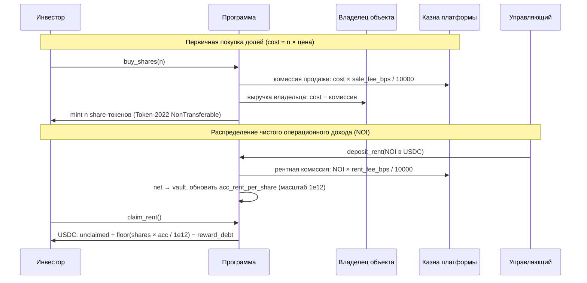

# Платежи и стейблкоины в Roofic

## 1. Почему стейблкоин

В MVP (неделя 8) всё оплачивалось в SOL. Для аренды это плохо: арендная плата и цена доли номинированы в долларах, а SOL колеблется. Инвестор может «заработать» 6% годовых в долларах и потерять 30% на курсе SOL. Стейблкоин убирает курсовой риск из учёта аренды.

**Цена этого решения:** появляется эмитент, которому приходится доверять (см. §5).

## 2. Выбор платёжного токена

| Токен | Программа на Solana | Особенности для нас |
|-------|---------------------|---------------------|
| **USDC** (Circle) | Классический SPL Token | У эмитента есть mint authority и **freeze authority** (заморозка счетов по требованию закона) |
| **PYUSD** (PayPal / Paxos) | Token-2022 | Тоже regulated-эмитент с freeze authority; Token-2022 допускает расширения вроде transfer hook |

> Подробности (адреса mint, поддерживаемые расширения, условия эмитента) перед запуском нужно сверять с документацией эмитентов: они меняются.

**Решение:** основной платёжный токен — USDC, но **программа не привязывается к одному токену**. Адрес платёжного mint хранится в конфигурации платформы, а переводы идут через `token_interface` с `transfer_checked`. Это работает и с классической программой токенов (USDC), и с Token-2022 (PYUSD, share-токены). Share-токены остаются Token-2022 (неделя 11), а платёжный токен — любой.

`transfer_checked` (а не `transfer`) обязателен: он сверяет `decimals` и mint, поэтому нельзя подсунуть счёт другого токена.

## 3. Потоки денег и граница off-chain / on-chain

> **Граница водопада доходов:** операционные расходы объекта (`opex`: налоги, ремонт, страховка) и вознаграждение УК (`manager_fee`) удерживаются управляющей компанией **вне сети** из собранной фиатной аренды при конвертации в USDC. В инструкцию `deposit_rent(amount)` поступает уже **чистый операционный доход (NOI)**, с которого смарт-контракт удерживает `rent_fee_bps` в `treasury`, а остаток направляет в `vault`. Именно поэтому в [`model/unit_economics.py`](model/unit_economics.py) и [`../capstone/scoring/engine.py`](../capstone/scoring/engine.py) комиссия платформы берётся от `NOI`.

| Поток | Кто платит | Кто получает | Комиссия |
|-------|-----------|--------------|----------|
| Покупка долей | Инвестор | Владелец объекта + Казна | Разовая комиссия листинга (`sale_fee_bps`) удерживается из выручки владельца (`cost - fee` → владельцу, `fee` → в `treasury`) |
| Внесение аренды (NOI) | Управляющий | Vault программы + Казна | `rent_fee_bps` уходит в казну в момент внесения, `amount - fee` — в `vault` |
| Выплата | Vault | Инвестор | Нет |

Разовая комиссия берётся с **владельца**, а не с инвестора: инвестор платит ровно `n × цена`. Так проще объяснить и проверить.

## 4. Инварианты денежных операций

Это то, что должны проверять тесты программы:

1. **Сохранение денег:** всё, что внесено в `deposit_rent`, равно комиссии + остаток в vault. Ничто не появляется и не исчезает.
2. **Выплаты не превышают vault:** сумма всех `claim` ≤ внесённая аренда − комиссия.
3. **Опоздавший инвестор не получает старую аренду** (accumulator + `reward_debt`, как в неделе 8).
4. **Нельзя купить сверх лимита** (supply mint-а — единственный источник истины, неделя 11).
5. **Только `transfer_checked`** и только с проверенным платёжным mint.
6. **Пауза блокирует покупки и внесение аренды**, но не блокирует `claim`: деньги инвесторов нельзя запирать.

### Округление
Все суммы — целые в минимальных единицах токена (у USDC 6 знаков). Деление с остатком даёт «пыль»: доли копеек, которые невозможно разделить без дроби. Эталон поведения — функция `distribute()` в [`model/unit_economics.py`](model/unit_economics.py): выплата каждому округляется вниз, остаток считается отдельно, и **сумма выплат + пыль всегда равна внесённой сумме**, а пыль меньше числа держателей. Тесты модели проверяют это на 500 случайных наборах. В программе пыль остаётся в vault и достаётся следующим выплатам, а не пропадает.

## 5. Риски стейблкоина

| Риск | Что произойдёт | Смягчение |
|------|----------------|-----------|
| Эмитент заморозил vault-счёт | Аренда застряла, claim невозможен | Мониторинг; процедура смены платёжного mint (в MVP не реализована) |
| Депег | Выплаты в «доллар», который стоит меньше | Не держать в vault больше нужного; мониторинг цены (Pyth, неделя 9) |
| Эмитент заморозил кошелёк инвестора | Инвестор не может получить claim | Вне нашего контроля, раскрывается в рисках |
| Ошибка в decimals | Сумма в 1000 раз больше или меньше | `transfer_checked` + тесты на конкретные суммы |
| Токен с `TransferFeeConfig` / `TransferHook` / `PermanentDelegate` | Фактически дошедшая в `vault` сумма меньше `net`, что приведёт к неплатёжеспособности пула при `claim_rent` | Ончейн-проверка `assert_clean_payment_mint` при `initialize_platform` отвергает такие mint с `UnsupportedPaymentMint` |

## 6. Экономика комиссий и гибридная точка безубыточности

Расчёт — [`model/unit_economics.py`](model/unit_economics.py), паспорта конкретных объектов — [`PRESETS.md`](PRESETS.md). **Все входные данные — иллюстративные допущения**, не рыночная статистика. Их нужно заменить реальными локальными цифрами.

Объект за $100 000, база: доходность 9%, вакантность 8%, расходы 20%, управляющий 5%, комиссия платформы с аренды 1%, разовая комиссия листинга 1,5%:

| Сценарий | NOI в год | Рентная комиссия (1%) | Разовая комиссия (1.5%) | Доход инвестора | Чистая доходность | Безубыточность (только рента)* | Безубыточность 1-го года (гибрид)* |
|----------|----------:|----------------------:|------------------------:|----------------:|------------------:|-------------------------------:|-----------------------------------:|
| bear | $4 165 | $41.65 | $1 500 | $4 123 | 4,12% | 865 | 24 |
| **base** | **$6 210** | **$62.10** | **$1 500** | **$6 148** | **6,15%** | **580** | **24** |
| bull | $8 448 | $84.48 | $1 500 | $8 364 | 8,36% | 427 | 23 |

\* При постоянных затратах платформы $3 000 в месяц ($36 000 в год — модельное допущение). В функции `listing_break_even_properties()` учтена только разовая комиссия (24 листинга/год), в `hybrid_break_even_properties()` — сумма разовой и годовой рентной комиссии за первый год.

### Главный вывод
**Комиссия 1% с аренды в одиночку не окупает платформу на старте.** При таких параметрах нужно около 580 объектов, чтобы одни только рентные комиссии покрыли $36 000 в год. Гибридная модель (`sale_fee_bps = 150` + `rent_fee_bps = 100`) снижает точку безубыточности первого года до **24 объектов по $100 000** (или ~$2.4M совокупного объёма размещений; на пилотном портфеле из 3 объектов в [`PRESETS.md`](PRESETS.md) на $430 000 выручка 1-го года составляет **$6 770.29**).

Следствия для дизайна:
- Обе комиссии должны быть **настраиваемыми параметрами** конфигурации с жёстким верхним пределом (`MAX_FEE_BPS = 2 000` = 20%), а не константами без потолка.
- Каждый добавленный пункт рентной комиссии уменьшает доход инвестора ровно на ту же сумму (проверено тестом модели). В сценарии bear чистая доходность и так всего 4,12%, поэтому запас для повышения комиссии мал.
- Перед запуском нужны реальные затраты и реальная арендная статистика, иначе эти числа остаются упражнением.

## 7. Соответствие параметров модели и контракта

| Параметр модели (`unit_economics.py`) | Поле / константа в контракте (`capstone/programs/roofic`) |
|-----------------|-----------------------------|
| `MAX_FEE_BPS = 2_000` (потолок 20%) | `MAX_FEE_BPS` (`RooficError::FeeTooHigh`) |
| `ACC_SCALE = 10**12` | `ACC_SCALE` (`Property.acc_rent_per_share: u128`) |
| `platform_rent_fee_bps` | `PlatformConfig.rent_fee_bps` |
| `platform_sale_fee_bps` | `PlatformConfig.sale_fee_bps` |
| Платёжный токен | `PlatformConfig.payment_mint` (проверен `assert_clean_payment_mint`) |
| Пауза | `PlatformConfig.paused` (не блокирует `claim_rent`) |
| Казна | `PlatformConfig.treasury` |
| Выпущенные доли (`shares_sold`) | `Property.shares_sold` (защищено от `Burn`-манипуляций) |
| Позиция инвестора | `Position.shares`, `Position.reward_debt`, `Position.unclaimed` |
