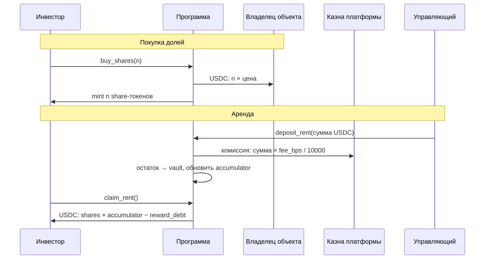

# Платежи и стейблкоины в Roofic

## 1. Почему стейблкоин

В MVP (неделя 8) всё оплачивалось в SOL. Для аренды это плохо: арендная плата и цена доли номинированы в долларах, а SOL колеблется. Инвестор может «заработать» 6% годовых в долларах и потерять 30% на курсе SOL. Стейблкоин убирает курсовой риск из учёта аренды.

**Цена этого решения:** появляется эмитент, которому приходится доверять (см. §5).

## 2. Выбор платёжного токена

| Токен | Программа на Solana | Особенности для нас |
|-------|---------------------|---------------------|
| **USDC** (Circle) | Классический SPL Token | У эмитента есть mint authority и **freeze authority** (заморозка счетов по требованию закона) |
| **PYUSD** (PayPal / Paxos) | Token-2022 | Тоже regulated-эмитент с freeze authority; Token-2022 допускает расширения вроде transfer hook |

> Подробности (адреса mint, поддерживаемые расширения, условия эмитента) перед запуском нужно сверять с документацией эмитентов: они меняются.

**Решение:** основной платёжный токен — USDC, но **программа не привязывается к одному токену**. Адрес платёжного mint хранится в конфигурации платформы, а переводы идут через `token_interface` с `transfer_checked`. Это работает и с классической программой токенов (USDC), и с Token-2022 (PYUSD, share-токены). Share-токены остаются Token-2022 (неделя 11), а платёжный токен — любой.

`transfer_checked` (а не `transfer`) обязателен: он сверяет `decimals` и mint, поэтому нельзя подсунуть счёт другого токена.

## 3. Потоки денег

| Поток | Кто платит | Кто получает | Комиссия |
|-------|-----------|--------------|----------|
| Покупка долей | Инвестор | Владелец объекта | Разовая комиссия листинга (`sale_fee_bps`) удерживается из выручки владельца |
| Внесение аренды | Управляющий | Vault программы | `rent_fee_bps` уходит в казну в момент внесения |
| Выплата | Vault | Инвестор | Нет |

Разовая комиссия берётся с **владельца**, а не с инвестора: инвестор платит ровно `n × цена`. Так проще объяснить и проверить.

## 4. Инварианты денежных операций

Это то, что должны проверять тесты программы:

1. **Сохранение денег:** всё, что внесено в `deposit_rent`, равно комиссии + остаток в vault. Ничто не появляется и не исчезает.
2. **Выплаты не превышают vault:** сумма всех `claim` ≤ внесённая аренда − комиссия.
3. **Опоздавший инвестор не получает старую аренду** (accumulator + `reward_debt`, как в неделе 8).
4. **Нельзя купить сверх лимита** (supply mint-а — единственный источник истины, неделя 11).
5. **Только `transfer_checked`** и только с проверенным платёжным mint.
6. **Пауза блокирует покупки и внесение аренды**, но не блокирует `claim`: деньги инвесторов нельзя запирать.

### Округление
Все суммы — целые в минимальных единицах токена (у USDC 6 знаков). Деление с остатком даёт «пыль»: доли копеек, которые невозможно разделить без дроби. Эталон поведения — функция `distribute()` в [`model/unit_economics.py`](model/unit_economics.py): выплата каждому округляется вниз, остаток считается отдельно, и **сумма выплат + пыль всегда равна внесённой сумме**, а пыль меньше числа держателей. Тесты модели проверяют это на 500 случайных наборах. В программе пыль остаётся в vault и достаётся следующим выплатам, а не пропадает.

## 5. Риски стейблкоина

| Риск | Что произойдёт | Смягчение |
|------|----------------|-----------|
| Эмитент заморозил vault-счёт | Аренда застряла, claim невозможен | Мониторинг; процедура смены платёжного mint (в MVP не реализована) |
| Депег | Выплаты в «доллар», который стоит меньше | Не держать в vault больше нужного; мониторинг цены (Pyth, неделя 9) |
| Эмитент заморозил кошелёк инвестора | Инвестор не может получить claim | Вне нашего контроля, раскрывается в рисках |
| Ошибка в decimals | Сумма в 1000 раз больше или меньше | `transfer_checked` + тесты на конкретные суммы |

## 6. Экономика комиссий

Расчёт — [`model/unit_economics.py`](model/unit_economics.py). **Все входные данные — иллюстративные допущения**, не рыночная статистика. Их нужно заменить реальными локальными цифрами.

Объект за $100 000, база: доходность 9%, вакантность 8%, расходы 20%, управляющий 5%, комиссия платформы с аренды 1%, разовая комиссия листинга 1,5%:

| Сценарий | NOI в год | Комиссия платформы | Доход инвестора | Чистая доходность | Объектов для безубыточности* |
|----------|----------:|-------------------:|----------------:|------------------:|-----------------------------:|
| bear | $4 165 | $42 | $4 123 | 4,12% | 865 |
| **base** | **$6 210** | **$62** | **$6 148** | **6,15%** | **580** |
| bull | $8 448 | $84 | $8 364 | 8,36% | 427 |

\* Только по комиссии с аренды, при постоянных затратах $3 000 в месяц (тоже допущение).

### Главный вывод
**Комиссия 1% с аренды не покрывает платформу.** При таких параметрах нужно около 580 объектов, чтобы одни только рентные комиссии окупили $36 000 в год. Реалистичнее первое время жить на разовой комиссии листинга: $1 500 с объекта означает **24 листинга в год** для покрытия тех же затрат.

Следствия для дизайна:
- Обе комиссии должны быть **настраиваемыми параметрами** конфигурации, а не константами в коде (в Capstone: `rent_fee_bps`, `sale_fee_bps`).
- Каждый добавленный пункт рентной комиссии уменьшает доход инвестора ровно на ту же сумму (проверено тестом модели). В сценарии bear чистая доходность и так всего 4,12%, поэтому запас для повышения комиссии мал.
- Перед запуском нужны реальные затраты и реальная арендная статистика, иначе эти числа остаются упражнением.

## 7. Соответствие параметров модели и контракта

| Параметр модели | Поле в контракте (Capstone) |
|-----------------|-----------------------------|
| `platform_rent_fee_bps` | `PlatformConfig.rent_fee_bps` |
| `platform_sale_fee_bps` | `PlatformConfig.sale_fee_bps` |
| Платёжный токен | `PlatformConfig.payment_mint` |
| Пауза | `PlatformConfig.paused` |
| Казна | `PlatformConfig.treasury` |
