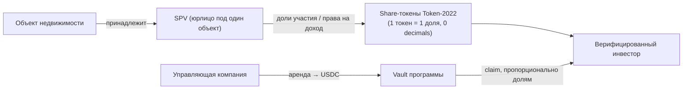

# RWA-дизайн Roofic: токенизация арендной недвижимости

> **Статус документа:** проектное решение для курса. Юридические положения ниже — **допущения**, а не юридическая консультация. Их нужно подтвердить юристом нужной юрисдикции до выхода к реальным инвесторам (см. раздел «Открытые вопросы»).

## 1. Что именно токенизируется

Токен не является «владением квартирой» напрямую. Рабочая модель:

- **SPV на объект** изолирует риск: долги или иск по одному объекту не затрагивают другие.
- **Токен = цифровое представление доли в SPV.** Он имеет силу только если эту связь признаёт юридическая документация (устав SPV, договор). *Допущение: юрисдикция и точная форма (доли в ООО, ценные бумаги, цифровые активы) выбираются с юристом.*
- **Источник дохода — аренда в фиате.** Управляющий переводит её в USDC и вносит в программу. Это **офчейн-доверие**, самая слабая точка модели (см. риски).

## 2. Участники

| Роль | Что делает | Ключ / полномочия |
|------|-----------|-------------------|
| Инвестор | Проходит KYC, покупает доли, получает аренду | Свой кошелёк |
| Владелец объекта | Листит объект, получает деньги от продажи долей | Кошелёк владельца (`authority` листинга) |
| Управляющий | Собирает аренду, вносит её в программу | Роль `manager` в листинге |
| Платформа (admin) | KYC-whitelist, пауза, комиссия | Мультисиг, не один ключ |
| Оценщик | Подтверждает стоимость объекта | Только хэш отчёта в сети |

## 3. Матрица контролей: требование → механизм

| Требование | Механизм в сети | Что остаётся вне сети | В Capstone |
|------------|-----------------|------------------------|:----------:|
| Покупать могут только прошедшие KYC | PDA-запись `Investor` (создаёт admin после проверки); `buy_shares` её требует | Сама проверка личности у KYC-провайдера | ✅ |
| Аварийная остановка | Флаг `paused` в конфигурации платформы | Процедура принятия решения о паузе | ✅ |
| Комиссия платформы | `rent_fee_bps` (с аренды) и `sale_fee_bps` (с продажи) в конфигурации; аренда удерживается при внесении | Учёт и отчётность | ✅ |
| Платёж в стейблкоине | Платёжный mint хранится в конфигурации, `transfer_checked` | On/off-ramp у управляющего | ✅ |
| Защита от выпуска сверх лимита | Mint authority — PDA листинга, лимит по `supply` (неделя 11) | — | ✅ |
| Ограничение вторичных переводов только для KYC-кошельков | В Capstone пробел закрыт **полным запретом переводов** (`NonTransferable`), а не whitelist-ом. Вторичный рынок — `TransferHook`, варианты ниже | Реестр держателей | ⚠️ частично (запрет; рынка нет) |
| Принудительное изъятие по решению суда / потеря ключа | **Не реализовано.** `PermanentDelegate` | Судебная процедура | ❌ (дизайн) |
| Подтверждение стоимости объекта | Хэш отчёта + дата в листинге | Сам отчёт оценщика | ✅ (хэш) |

### Ограничение вторичных переводов: варианты

Share-токен — обычный Token-2022, поэтому после покупки его можно отправить на любой кошелёк, и получатель окажется держателем без KYC. Для регулируемого актива это пробел. Варианты:

| Вариант | Как работает | Плюсы | Минусы |
|---------|--------------|-------|--------|
| **TransferHook** | Mint указывает программу-хук, она вызывается на каждый перевод и проверяет whitelist обеих сторон | Проверка на каждом переводе, без ручных действий | Отдельная программа и экстра-аккаунты в каждом переводе; **несовместим с ConfidentialTransfer** |
| **DefaultAccountState = Frozen** | Новые token-аккаунты создаются замороженными; admin размораживает после KYC | Нет доп. программы | Ручное размораживание; `mint_to` в замороженный аккаунт падает, значит нужно размораживать аккаунт **до** покупки; freeze authority — точка централизации |
| **NonTransferable** | Токен нельзя переводить вообще | Максимально просто | Нет вторичного рынка, а ценность токенизации в ликвидности |

> **Что выбрано в Capstone.** В [`capstone/`](../capstone/) share-mint создаётся с `NonTransferable`: перевести токен нельзя вообще (тест `shares_cannot_be_transferred_between_wallets`). Это закрывает пробел «получатель без KYC» и заодно защищает от двойного клейма аренды (клейм → пересылка токена → повторный клейм), но **вторичного рынка нет**. Токены недели 11 (`roofic_shares`) — обычные Token-2022 и переводимы, поэтому описанный выше пробел относится к ним, а не к Capstone. Расширение задаётся при создании mint и не меняется, значит переход на `TransferHook` потребует нового mint и миграции держателей.

**Рекомендация:** для запуска — `TransferHook` (проверка whitelist на каждом переводе). В Capstone он **не реализуется**: фиксируется как ограничение. Расширения Token-2022 включаются **только при создании mint**, поэтому решение нужно принять до первого выпуска. Позже их не добавить. Совместимость расширений тоже ограничена: например, `NonTransferable` нельзя сочетать с `TransferFeeConfig`.

### PermanentDelegate

Позволяет эмитенту сжигать или переводить токены **с любого счёта**. Это инструмент для судебных решений и восстановления потерянных ключей, но одновременно **полный контроль над активами инвесторов**. Если включать, это нужно раскрывать в документации для инвесторов, а ключ держать в мультисиге. Для Capstone — не включаем.

## 4. Модель доверия

Что инвестор вынужден принимать на веру, даже при идеальном смарт-контракте:

1. **Владение.** Что SPV действительно владеет объектом, а токен действительно даёт права на эту долю.
2. **Аренда.** Что управляющий вносит *всю* собранную аренду, а не часть. Программа проверяет, что внесённое распределяется честно, но не может проверить, сколько реально собрано.
3. **Оценка.** Что отчёт оценщика достоверен. В сети лежит только его хэш.
4. **Админ-ключи.** Что admin не злоупотребит паузой и whitelist.

Смягчение (на уровне процесса, не кода): мультисиг для admin; публикация хэшей банковских выписок вместе с внесением аренды; аудит программы по чек-листу недели 12.

## 5. Реестр рисков

| Риск | Вероятность | Влияние | Смягчение |
|------|:-----------:|:-------:|-----------|
| Токен не признан юридически долей | Средняя | Критическое | Юрист до запуска; документация SPV |
| Управляющий вносит неполную аренду | Средняя | Высокое | Хэши выписок, аудит, залог/штраф в договоре |
| Эмитент стейблкоина заморозит vault | Низкая | Высокое | Мониторинг; возможность сменить платёжный mint (в MVP нет) |
| Депег стейблкоина | Низкая | Среднее | Лимит на сумму в одном vault; мониторинг цены |
| Уязвимость смарт-контракта | Средняя | Критическое | Тесты эксплойтов, аудит по чек-листу недели 12 |
| Компрометация admin-ключа | Низкая | Критическое | Мультисиг, пауза, ротация |
| Нет ликвидности вторичного рынка | Высокая | Среднее | Честное раскрытие; фиксированный срок |
| Регуляторный запрет или изменение правил | Средняя | Критическое | Юрист; готовность приостановить продажи |

## 6. Модуль оценки доходности и риска (ML)

**Честный объём для Capstone.** Реальных исторических данных об аренде у проекта нет, поэтому обучать модель не на чем. Выдавать синтетическую регрессию за «ML-прогноз» было бы обманом.

| Версия | Что это | Когда |
|--------|---------|-------|
| **v1 (Capstone)** | Прозрачный **расчётный скоринг**: сценарии bear/base/bull из модели недвижимости, риск-скор из формулы с весами, у каждого числа есть объяснение | Неделя 14 |
| v2 | Обучение на реальных данных объявлений и сделок | Только когда появятся данные |

**Вход:** цена, ожидаемая арендная доходность, вакантность, доля расходов, комиссии.
**Выход:** чистая доходность инвестора по трём сценариям, риск-скор 0–100 с разложением по факторам, предупреждения (например, доходность ниже порога).
Реализация и тесты — в [`../capstone`](../capstone/) и в [`model/unit_economics.py`](model/unit_economics.py).

## 7. Открытые вопросы (нужны юрист и команда)

1. Юрисдикция SPV и правовая форма токена. От этого зависят лицензии, раскрытие и допустимый круг инвесторов.
2. Ограничения по числу и типу инвесторов (квалифицированные или нет).
3. Налогообложение арендного дохода и выплат в стейблкоине.
4. Кто и как верифицирует отчёты оценщика и управляющего.
5. Выбор механизма вторичных переводов (TransferHook или иной) **до первого выпуска токена**.
6. Правила выхода: срок жизни SPV, выкуп долей, продажа объекта.

## 8. Что построено, а что только описано

| Элемент | Статус |
|---------|--------|
| Share-токен Token-2022, mint authority = PDA | ✅ неделя 11 |
| Защита от типовых уязвимостей | ✅ неделя 12 |
| KYC-whitelist, пауза, комиссия, платёж в стейблкоине | ✅ Capstone (неделя 14) |
| Расчётная модель доходности и риска | ✅ неделя 13–14 |
| Запрет вторичных переводов (`NonTransferable`) | ✅ Capstone (вынужденная замена whitelist-а) |
| Ограничение вторичных переводов только для KYC (TransferHook) | ❌ только дизайн |
| PermanentDelegate / судебное изъятие | ❌ только дизайн |
| Юридическая оболочка, KYC-провайдер, on/off-ramp | ❌ вне кода |

